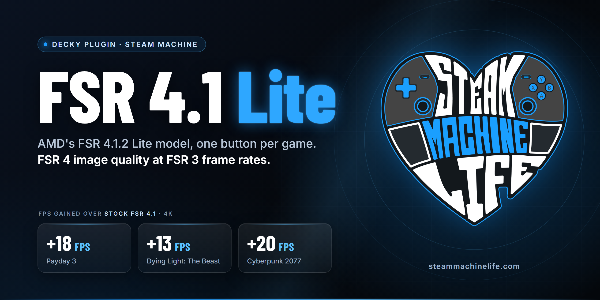

<p align="center">
  
</p>

<p align="center">
  <a href="https://github.com/db1522/fsr4-lite-steam-machine/releases/latest"></a>
  <a href="https://github.com/db1522/fsr4-lite-steam-machine/releases"></a>
  
  
  <a href="https://steammachinelife.com/fsr-4-1-2-lite-steam-machine/"></a>
  <a href="https://ko-fi.com/steammachinelife"></a>
</p>

FSR 4.1 Lite is a Decky Loader plugin that runs AMD's FSR 4.1.2 Lite model in your games on the Steam Machine. Lite is the smaller ML upscaler AMD built for handheld chips. On the Steam Machine it costs about as much as FSR 3 and looks close to full FSR 4.1, which is the trade I've wanted since I started testing this hardware. Full FSR 4.1 runs through Proton Experimental too, but it can cost up to 20 FPS next to Lite. Lite is the FSR the Steam Machine should be using by default.

It does it one way for every game, the same way my [FSR 4.1 Lite widget for Windows](https://github.com/db1522/fsr4-lite-rog-ally) does: OptiScaler goes next to the game, takes over the game's upscaler and runs FSR 4.1 Lite in its place. You press one button per game, and turning it off puts every file and launch option back as it was. No terminal. The widget has been downloaded over 54,000 times, and this plugin brings the same method to SteamOS.

The full guide, with how I tested and what to pick in each game, is on Steam Machine Life: [FSR 4.1.2 Lite on the Steam Machine](https://steammachinelife.com/fsr-4-1-2-lite-steam-machine/).

## Results

Same spot, 4K output, Proton Experimental's stock FSR 4.1 against FSR 4.1 Lite, on my own Steam Machine.

| Game | Engine | Stock FSR 4.1 → Lite |
|---|---|---|
| Payday 3 | Unreal Engine | 44 → 62 FPS (+18) |
| VOID/BREAKER | Unreal Engine | 45 → 60 FPS (+15) |
| Phantom Blade Zero | Unreal Engine | about +20 FPS |
| Kingdom Come: Deliverance II | CryEngine | 10+ FPS |
| Cyberpunk 2077 | REDengine 4 | 20+ FPS |
| Dying Light: The Beast | C-Engine | 21 → 34 FPS (+13) |
| Resident Evil Requiem | RE Engine | 47 → 67 FPS (+20) |

Xbox Series X|S games are getting the same FSR 4.1.2 Lite model. Microsoft's [Xbox GDK FSR sample](https://github.com/microsoft/Xbox-GDK-Samples/tree/main/Samples/Graphics/AMD_FSR) switches between Full and Lite, and on Series X at 4K the Lite upscaling pass takes 2.75 ms against 3.86 ms for Full. That's the model this plugin runs.

## DLSS, XeSS and FSR 2 games run FSR 4.1.2 Lite too

This is the part I'm most excited about. A lot of games only offer DLSS, and on an AMD Steam Machine that option is normally greyed out or missing. Others are stuck on an old FSR 2. With the plugin set up, OptiScaler unlocks the game's DLSS option or takes over its FSR 2, and the plugin runs FSR 4.1.2 Lite in its place. You get AMD's newest upscaler in games that never shipped it.

XeSS works the same way: pick XeSS in a game that offers it and Lite runs instead. I don't know of a game that ships XeSS and nothing else, so the table sticks to DLSS and FSR 2.

| Game | Upscalers the game ships | Pick in its settings | What runs |
|---|---|---|---|
| Palworld | DLSS only | DLSS | FSR 4.1.2 Lite |
| Control | DLSS only | DLSS | FSR 4.1.2 Lite |
| God of War | DLSS, its own FSR 2 | DLSS | FSR 4.1.2 Lite |
| Red Dead Redemption 2 | FSR 2.0, DLSS | FSR 2.0, with Graphics API set to DirectX 12 | FSR 4.1.2 Lite |

In Red Dead Redemption 2 it's a trade. With the same settings at 4K, its built-in benchmark averaged 61.0 FPS on the game's own FSR 2.0 and 52.5 FPS on FSR 4.1.2 Lite, with the lows the same at about 30 FPS. FSR 2.0 is a light upscaler from 2022; Lite is AMD's ML model, so you give up about 8 FPS for a much cleaner image.

All tested on my own Steam Machine. Set the game up from Now playing, restart it, then pick the upscaler from the table in its graphics settings. The notification tells you when it's running, for example "DLSS → FSR 4.1.2 Lite, 1280×720 → 3840×2160".

## What you get

- DLSS, XeSS and FSR 2 games on FSR 4.1.2 Lite. Games that only offer DLSS get their DLSS option unlocked, older FSR 2 games get taken over, and XeSS works too. All of them run Lite instead.
- A Now playing card. Open the plugin in a game and you see the game, which upscalers it ships, and one button to install or uninstall. It sets the game up next to the program that's really running, the same way the Windows widget does.
- Your games: every game you set up, each with a badge: live while the game runs, otherwise what its last session showed (Active, Pick an upscaler, Needs fix or Not played yet), and a switch to turn it off. The rest of your games with FSR, DLSS or XeSS are listed underneath.
- Proof that Lite ran. OptiScaler's log is read during the game, and a notification pops up as soon as the Lite model is running.
- Crash protection. If a game closes right after starting two times in a row with FSR 4.1 Lite on, the plugin turns it off for that game, puts your launch options back and tells you why. Turn it back on any time to try again.
- It sorts itself out. If OptiScaler doesn't load in a game, the plugin sets it up under the next file name OptiScaler can load as and asks for one more session. If a game update or Steam's file check removes OptiScaler, the plugin puts it back and tells you.
- Check setup, a page per game that checks the files, the launch option, Proton and the last session, with a Fix setup button and a report you can save to Downloads.
- OptiScaler's newest nightly, always. The plugin checks for a new build every 6 hours, the same as the Windows widget, and puts it in every game you set up that isn't running. Each game keeps its settings, and one notification tells you. Turn it off in Settings if you'd rather stay put.
- OptiScaler's FPS and resolution overlay, and AMD's watermark, each one switch for every game.

## Requirements

- A Steam Machine in SteamOS Gaming Mode with [Decky Loader](https://decky.xyz)
- A game that ships FSR 2, FSR 3.1, native FSR 4, DLSS or XeSS, in DirectX 12, DirectX 11 or Vulkan
- Proton Experimental is what I test with; any recent Proton should work

The plugin downloads about 205 MB once: OptiScaler's newest nightly from its own GitHub, and AMD's signed FSR 4.1.2 files. After that, only new OptiScaler builds (about 55 MB each). Nothing from AMD or OptiScaler is in this repository or the release.

## Install

1. Download `FSR4Lite-<version>.zip` from the [latest release](https://github.com/db1522/fsr4-lite-steam-machine/releases/latest). Use the browser in Desktop Mode, or copy the file to the Steam Machine's Downloads folder from another PC.
2. In Gaming Mode, open the Quick Access Menu, then **Decky → Settings**, and turn on **Developer mode** under General.
3. Open **Developer → Install Plugin from ZIP** and pick the file.
4. Open **FSR 4.1 Lite** in Decky and press **Accept and download**.

The plugin checks GitHub for a new version every hour and sends a notification when one is out. To update, press **Update** on the card at the top of the plugin, or use **Check for updates** in its Updates section. It downloads the new release from GitHub, checks it, and hands it to Decky, which asks you to confirm and reloads the plugin. Your games stay set up.

Coming from version 1? The plugin shows a **Clean up** card for games version 1 set up. Press it first.

## Using it

1. Start the game and wait for its menu. Open the plugin and press **Install FSR 4.1 Lite** on the Now playing card. I set games up this way only, with the game running, so the plugin sees exactly which program is the game.
2. Restart the game, or press **Restart now** on the card. In its graphics settings, pick FSR, DLSS or XeSS as the upscaler, whichever it offers. OptiScaler swaps it for FSR 4.1 Lite.
3. Play. With **Notify when active** on, a notification tells you when Lite is running, and the game's chip turns green: **Active**.

If a notification says the plugin is trying another file name, play once more. That's OptiScaler finding the name this game loads it under.

## Which games work

The plugin's **Your games** section lists every installed game with FSR, DLSS or XeSS. As a rule, if the game lets you pick one of those upscalers, FSR 4.1 Lite can take it over.

[PCGamingWiki's upscaling list](https://www.pcgamingwiki.com/wiki/List_of_games_that_support_high-fidelity_upscaling) shows which upscalers a game ships.

It stays off for:

- Online games with anti-cheat (Easy Anti-Cheat, BattlEye and others). Adding DLLs to them can get you banned, so the plugin won't install there.
- Games that already have OptiScaler from another install, until you press **Remove old OptiScaler** on the Now playing card. It moves that install's files into the plugin's folder (`~/homebrew/data/FSR4Lite/old-optiscaler`), so nothing is deleted, and leaves the game's own files alone.
- Games with only FSR 1, or no upscaler at all. OptiScaler needs FSR 2 or newer, DLSS or XeSS to take over. A game that builds FSR 2 or 3 in without separate files can still be set up from Now playing.

## Troubleshooting

Start with **Check setup** for the game. Each line says what's wrong and what to press.

| Check setup says | What to do |
|---|---|
| OptiScaler didn't load | Play once more: the plugin has already set it up under the next file name. |
| The game used FSR 3, or The upscaler didn't start | Pick FSR, DLSS or XeSS as the upscaler in the game's graphics settings, then restart the game. |
| Files missing, or Launch option missing | A game update or Steam's file check removed them. Press **Fix setup**. |
| FSR 4 can't run here | Save a report and open an issue with it. |

Still stuck? Press **Save report to Downloads** in Check setup and [open an issue](https://github.com/db1522/fsr4-lite-steam-machine/issues/new?template=bug_report.yml) with the file.

## Uninstall

Press **Uninstall from all games** in the plugin first. That puts every game back as it was. Then remove the plugin in Decky's settings.

## How it works

For each game, the plugin finds the folder of the real game exe (for Unreal games, the `-Shipping.exe` under `Binaries/Win64`), copies OptiScaler there under a file name the game loads (`dxgi.dll` first), puts AMD's FSR 4.1.2 files in OptiScaler's own folder next to it, and adds `WINEDLLOVERRIDES=dxgi=n,b` to the launch options so Proton loads it. OptiScaler's settings are the Windows widget's: the game's upscaler goes through FidelityFX, FSR 4 support is forced to INT8 Lite and the Lite model is picked, frame generation stays off, and OptiScaler logs each session.

Anything an install would replace is backed up first and put back on uninstall. AMD's files and OptiScaler are never modified, Proton isn't touched, and nothing is installed outside the game's folder.

## Support

FSR 4.1 Lite is free, and so are the settings guides on [Steam Machine Life](https://steammachinelife.com). If the plugin gave you frames back, you can buy me a coffee on [Ko-fi](https://ko-fi.com/steammachinelife). It keeps the testing going.

## Building from source

Node.js 24 and Python 3.10 or newer.

```
npm ci --ignore-scripts --no-audit --no-fund
npm run check      # types, backend and frontend tests, build, package
```

## Credits

- [OptiScaler](https://github.com/optiscaler/OptiScaler) by cdozdil and contributors, which does the actual work in every game.
- [REFramework](https://github.com/praydog/REFramework) by praydog. Capcom's RE Engine games need it for OptiScaler to load, so the plugin adds it to those games.
- [OptiPatcher](https://github.com/optiscaler/OptiPatcher) by the OptiScaler team. Some games, like DOOM Eternal, only show DLSS on AMD with it, so the plugin adds it to the games OptiScaler's Compatibility List marks for it.
- AMD for FSR 4, and TheRazerMD for making the FSR 4.1.2 files available to the community.
- [FSR4 Injector](https://github.com/Rayekkk/FSR4Injector) by Rayekkk. Version 1 of this plugin was built on it, and its library scan, launch option handling and updater still are.
- [7-Zip](https://www.7-zip.org) by Igor Pavlov, bundled to unpack OptiScaler.

## License

Plugin code is BSD-3-Clause ([LICENSE](LICENSE)). `bin/7zz` is 7-Zip under the GNU LGPL ([bin/7zz-License.txt](bin/7zz-License.txt)). OptiScaler (GPL-3.0), REFramework (MIT), OptiPatcher (MIT) and AMD's files aren't included; the plugin downloads them unmodified at setup. Barlow Condensed is under the SIL Open Font License 1.1. Full details are in [NOTICE](NOTICE).

Not affiliated with AMD, Valve or the OptiScaler project. The plugin places files in game folders and is provided as is, without warranty.

<p align="center">
  <a href="https://steammachinelife.com"><b>Steam Machine Life</b></a><br>
  <sub>Tested settings, FPS benchmarks and guides for the Steam Machine</sub>
</p>
